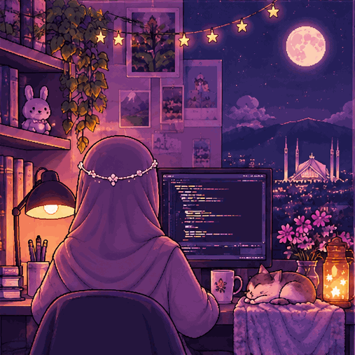

<!-- Upload your cropped pixel-art header to assets/pixel-banner.png -->

  

<h2 align="center">🍩 Hey there! I'm Ayesha Faryal.</h2>

  <b>AI Undergraduate @ FAST-NUCES | 5th Semester</b>

  <b><i>Building intelligent things.</i></b>

---

<table>
<tr>
<td width="55%" valign="top">

### 🌸 About Me

- 🎓 BS Artificial Intelligence student at FAST-NUCES.
- 🧠 Exploring AI and Machine Learning.
- 🤖 Fascinated by Agentic AI and Robotics.
- 💻 Love programming and problem-solving.
- 🌱 Learning something new every day.

</td>
<td width="45%" valign="top">

### 🧸 Currently Exploring

- Artificial Intelligence
- Machine Learning
- Autonomous Agents
- Robotics

</td>
</tr>
</table>

### 🛠️ My Digital Toolbox

  

### 🛠️ My Digital Toolbox

  

  

  <code>Assembly</code> · <code>Git</code> · <code>GitHub</code>

  <code>Assembly</code> · <code>Git</code> · <code>GitHub</code>

### 🧠 Things That Fascinate Me

<table>
<tr>
<td align="center">🧠 <b>AI / ML</b> Intelligent systems</td>
<td align="center">🤖 <b>Agentic AI</b> Autonomous agents</td>
<td align="center">⚙️ <b>Robotics</b> Smart machines</td>
</tr>
</table>

### Thanks for visiting my little corner!✨🎀

*"Dream. Code. Create. Repeat."*

